# VaultRoute RAG

> A secure, permission-aware company knowledge assistant with grounded answers, semantic caching, intelligent model routing, and measurable quality.

VaultRoute RAG lets employees ask questions across company documents without exposing information outside their current access scope. Authentication, authorization, document retrieval, cached answers, citations, audit records, and dashboards are all enforced by the server.

The project currently models one company, **ACME**, with five departments and nineteen seeded users. Its database design remains company-scoped so multi-tenant expansion can be added later.

## Why this project exists

A normal RAG system may find the right text but still return it to the wrong person. VaultRoute treats access control as part of the retrieval pipeline:

- employees see and query only documents they are authorized to access;
- Founder and CEO have company-wide access;
- explicit user denial overrides every allow rule, including global access;
- cached answers are never returned before their sources are authorized again;
- weak evidence is refused instead of guessed;
- every answer is grounded in retrieved sources and includes citations;
- latency, token use, estimated cost, cache hits, quality, and user feedback are measured;
- raw questions, answers, chunks, and document text are excluded from query audit records.

## Main features

- Argon2 password hashing and short-lived JWT authentication
- Server-built role and department permissions
- Company, department, role, user, company-wide, and explicit-deny document rules
- TXT, Markdown, HTML, PDF, and DOCX ingestion
- Deterministic overlapping chunking and local embeddings
- Permission-filtered semantic retrieval with PostgreSQL re-authorization
- Conflict and stale-version detection
- Groq small-model and OpenAI large-model routing
- Grounded generation with citation validation and prompt-injection protection
- Permission-safe semantic answer cache in Qdrant
- Privacy-safe audit events, runtime metrics, estimated model cost, and feedback
- Employee Q&A, document library, restricted uploads, and executive insights in one web portal
- Docker development stack, Alembic migrations, backups, tests, and hardened production configuration

## Access model

| Department | Roles | Default document access |
|---|---|---|
| Founding | Founder, CEO, Director, CTO | Founding documents |
| Engineering | Engineering Manager, Senior Developer, Junior Developer, QA Tester, Product Manager | Engineering documents |
| HR | HR Manager, HR Executive, Recruiter | HR documents |
| Design | Senior Designer, Product Designer, UI/UX Designer | Design documents |
| Business | Business Manager, Sales Officer, Business Development Executive, Account Manager | Business documents |

Important exceptions:

- **Founder and CEO** are global roles and can access all departments.
- **CTO** belongs to Founding and Engineering but is not globally authorized.
- **Product Manager** belongs to Engineering, Design, and Business.
- A document may also allow specific roles or users, be company-wide, or deny specific users.
- **Explicit denial is checked first**, so it overrides global, company-wide, role, department, and user allows.

The final decision order is:

```text
inactive/wrong company -> deny
explicit user deny     -> deny
global role            -> allow
explicit user allow    -> allow
company-wide document  -> allow
matching role          -> allow
matching department    -> allow
otherwise              -> deny
```

## System architecture

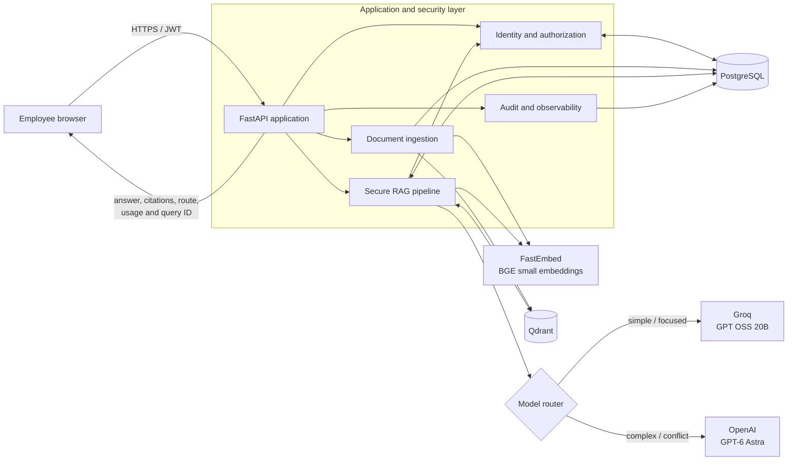

### Service responsibilities

| Service | Responsibility |
|---|---|
| FastAPI | UI, authentication, authorization, upload, retrieval, model calls, cache checks, audit logic, and security controls |
| PostgreSQL | Companies, users, password hashes, roles, departments, authoritative document rules/versions, query events, metrics, and feedback |
| Qdrant | Permission-tagged document vectors and semantic answer-cache vectors in separate collections |
| FastEmbed | Local 384-dimensional query and document embeddings using `BAAI/bge-small-en-v1.5` |
| Groq | Small/fast answer route using `openai/gpt-oss-20b` by default |
| OpenAI | Large reasoning route using `gpt-6-astra` by default |

## User flow

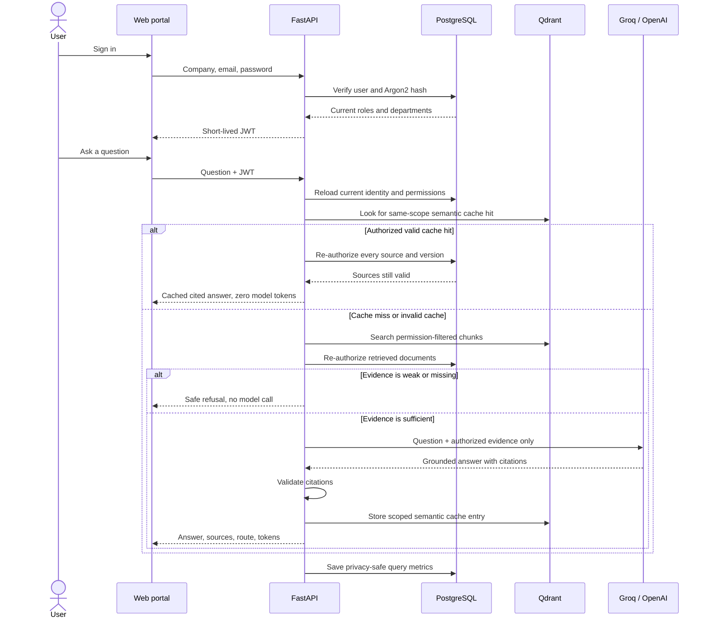

## Document ingestion flow

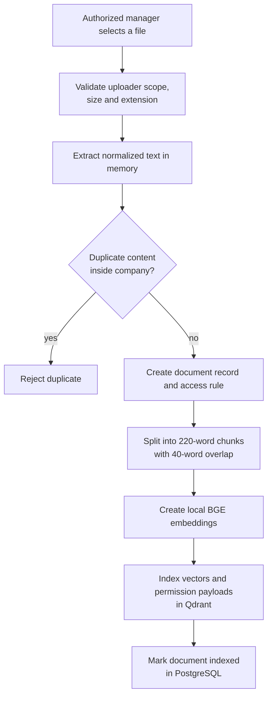

Uploaded files are not kept as a public file library. The application extracts supported text in memory, stores authoritative metadata and rules in PostgreSQL, and stores searchable chunks in Qdrant. The default upload limit is 10 MB.

## Secure retrieval logic

1. Validate the JWT, then reload the active user, roles, departments, and token version from PostgreSQL.
2. Embed the question locally.
3. Ask Qdrant for candidates filtered by company and permitted principals.
4. Recheck every candidate against the authoritative PostgreSQL document rule and current version.
5. Combine semantic relevance with a transparent lexical rerank.
6. Diversify results by source and detect conflicting/current versions.
7. Refuse if the strongest evidence is below the answer threshold.
8. Route sufficient evidence to the appropriate model.
9. Validate that the response cites only the supplied sources.

Authorization is therefore enforced twice: once during vector search and again against the source of truth before evidence is used.

## Permission-safe semantic cache

One shared Qdrant collection stores cache entries, but entries are logically isolated:

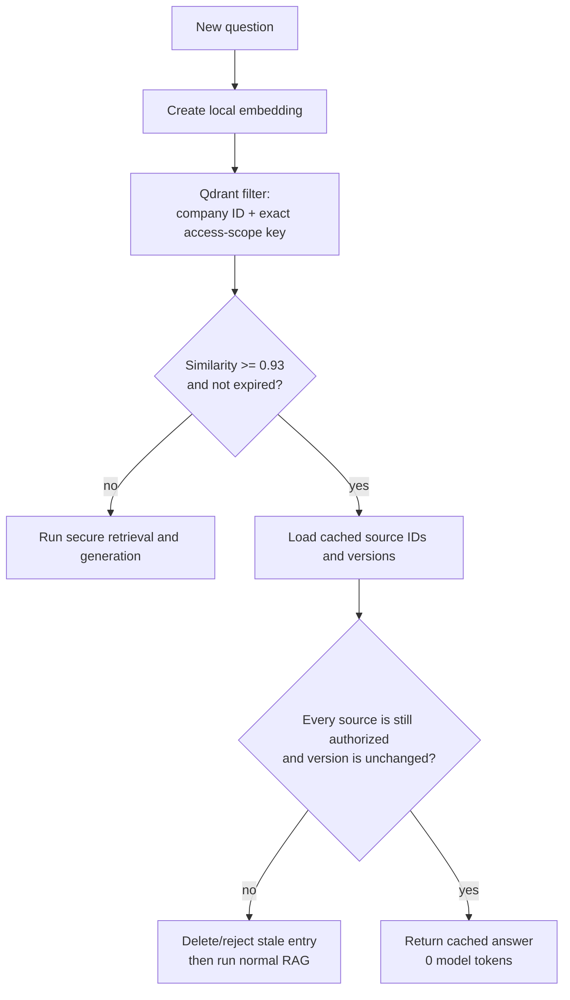

The access-scope key is derived from the complete company, global flag, role set, and department set. It is not merely a role name. A cache entry cannot bypass authorization because all cited sources are checked again before a hit is returned. Cache failure also fails open to the normal secure RAG path, not to an unverified answer.

Default cache settings:

| Setting | Default |
|---|---:|
| Similarity threshold | `0.93` |
| Candidate limit | `5` |
| Time to live | `86,400` seconds / 24 hours |
| Cache collection | `semantic_answer_cache` |

## Model routing

| Situation | Result |
|---|---|
| No evidence or maximum score below `0.50` | Safe refusal; no model cost |
| Valid semantic cache hit | Cached answer; zero model tokens |
| Simple, focused question | Groq small/fast route |
| Long or analytical question | Complexity score increases |
| Four or more retrieved sources | Complexity score increases |
| Source conflict | Strongly favors large route |
| Complexity score `>= 2` | OpenAI large route |
| Preferred provider unavailable | Configured provider fallback |

Model names, thresholds, token limit, timeouts, and cost estimates are environment-configurable.

## Audit, metrics, and answer quality

For each query, VaultRoute records:

- generated, cache-hit, refused, or failed outcome;
- total and stage-level response time;
- provider, model, input tokens, output tokens, and estimated cost;
- retrieval score, citations, conflict signal, and automatic quality score;
- cache-hit status and similarity;
- privacy-safe question fingerprint;
- optional 1-5 user rating and controlled issue labels.

The audit table intentionally excludes the raw question, answer, chunks, and document text. Metrics and query-audit views are restricted to Founder, CEO, CTO, and Director and remain company-scoped.

The automatic quality score combines retrieval strength, citation presence, and conflict coverage. It is an operational signal, not a replacement for human evaluation.

## Tech stack

| Area | Technology |
|---|---|
| Language | Python 3.11-3.13 |
| API and UI hosting | FastAPI, Uvicorn, buildless HTML/CSS/JavaScript |
| Validation and settings | Pydantic, pydantic-settings |
| Relational data | PostgreSQL 17, SQLAlchemy async, asyncpg, Alembic |
| Vector search and cache | Qdrant 1.20 |
| Embeddings | FastEmbed / ONNX, `BAAI/bge-small-en-v1.5` |
| File parsing | pypdf, python-docx, Python HTML parser |
| Authentication | Argon2, PyJWT |
| Small model | Groq `openai/gpt-oss-20b` |
| Large model | OpenAI `gpt-6-astra` |
| Testing and quality | pytest, pytest-asyncio, Ruff |
| Runtime and deployment | Docker, Docker Compose |

The RAG pipeline is implemented directly rather than through LangChain or LlamaIndex. This keeps authorization, reranking, cache validation, and model-routing behavior explicit and testable.

## Repository structure

```text
VaultRoute-RAG/
├── src/vaultroute_rag/
│   ├── api/                 # Routes, dependencies and middleware
│   ├── authorization/       # Access profiles and allow/deny evaluator
│   ├── cache/               # Permission-safe semantic answer cache
│   ├── core/                # Settings, logging and password security
│   ├── database/            # Async database lifecycle
│   ├── documents/           # Extraction, chunking, embeddings and indexing
│   ├── generation/          # Grounding, providers, routing and answer service
│   ├── identity/            # Company/user models, JWT and login
│   ├── observability/       # Audit, metrics, quality and feedback
│   ├── retrieval/           # Secure search and reranking
│   ├── web/                 # Employee portal
│   └── main.py              # Application factory and startup wiring
├── migrations/              # Alembic schema migrations
├── data/
│   ├── sample_documents/    # Two sample documents per department
│   └── evaluation/          # Retrieval/access-safety cases
├── scripts/                 # Seed, ingest, evaluate and backup utilities
├── tests/                   # Unit, integration, security and portal tests
├── screenshots/             # Images displayed in this README
├── docker-compose.yml       # Local three-service stack
├── docker-compose.prod.yml  # Hardened production template
├── Dockerfile
└── README.md
```

## Run locally

### Requirements

- Python 3.11, 3.12, or 3.13
- Docker Desktop with Docker Compose

### 1. Create the local environment

```powershell
Copy-Item .env.example .env
python -m venv .venv
.\.venv\Scripts\Activate.ps1
python -m pip install --upgrade pip
pip install -e ".[dev]"
```

Keep `.env` private. For local answer generation, add one or both keys:

```dotenv
GROQ_API_KEY=your-private-groq-key
OPENAI_API_KEY=your-private-openai-key
```

Do not commit API keys. `/search` and weak-evidence refusals work without model keys; generating a supported answer requires at least one configured provider.

### 2. Start and prepare the services

```powershell
docker compose up -d --build
docker compose run --rm api alembic upgrade head
docker compose run --rm api python scripts/seed_database.py
docker compose run --rm -e VAULTROUTE_API_URL=http://api:8000 api python scripts/ingest_sample_documents.py
docker compose ps
```

Open:

- Portal: <http://localhost:8000/>
- API documentation: <http://localhost:8000/docs>
- Liveness: <http://localhost:8000/health/live>
- Readiness: <http://localhost:8000/health/ready>

### 3. Sign in

All seeded users use `SEED_USER_PASSWORD` from `.env`. The development-only default is `ChangeMe123!`.

| Example account | Purpose |
|---|---|
| `ceo@acme.example.com` | Global access, multi-department questions, uploads, executive insights |
| `cto@acme.example.com` | Founding + Engineering access and executive insights |
| `priya@acme.example.com` | Junior Developer; Engineering-only isolation test |
| `hr.manager@acme.example.com` | HR-only access and HR document upload |
| `senior.designer@acme.example.com` | Design-only access |
| `sales@acme.example.com` | Business-only access |

The seed script contains all nineteen test users.

### 4. Stop safely

```powershell
docker compose down
```

This removes the containers and Compose network while preserving PostgreSQL and Qdrant volumes. Use `docker compose down -v` only when you intentionally want to erase local data.

## Main API endpoints

| Method | Endpoint | Purpose |
|---|---|---|
| `POST` | `/auth/login` | Authenticate and receive a JWT |
| `GET` | `/auth/me` | Read the server-built access profile |
| `GET` | `/documents` | List only visible document metadata |
| `POST` | `/documents/upload` | Upload and index a permitted document |
| `POST` | `/search` | Retrieve authorized ranked evidence |
| `POST` | `/query` | Retrieve, route, generate, cite, cache, and audit |
| `POST` | `/feedback` | Rate the current user's query result |
| `GET` | `/metrics/summary` | Executive company metrics |
| `GET` | `/audit/queries` | Executive privacy-safe audit events |
| `GET` | `/health/live` | Process liveness |
| `GET` | `/health/ready` | PostgreSQL and Qdrant readiness |
| `GET` | `/health/metrics` | Prometheus-format runtime counters |

## Verification results

Latest completed local verification:

- **58 automated tests passed; 0 failed**
- Ruff lint and formatting checks passed
- **10/10** expected top-document retrieval cases passed
- **11/11** department access-safety cases passed
- Authorized semantic cache hit returned similarity `1.0` and zero model tokens
- Stale-version cache fixture was rejected and removed
- Real Groq answer returned an Engineering citation; exact repeat used cache
- CEO multi-document request exercised the OpenAI large route
- Employee metrics access was denied; CEO metrics access was allowed
- HR Manager upload succeeded and remained invisible to Engineering-only Priya
- Production Compose configuration validated
- PostgreSQL and both Qdrant collections were successfully backed up with checksums

Run the same checks:

```powershell
ruff check .
ruff format --check .
pytest
python scripts/run_rag_evaluation.py
```

## Screenshots

| Secure login | Role-scoped document library |
|---|---|
| 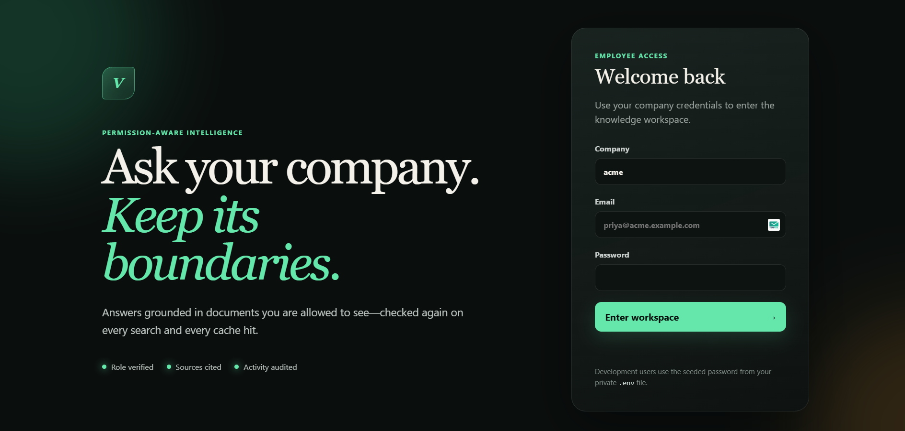 | 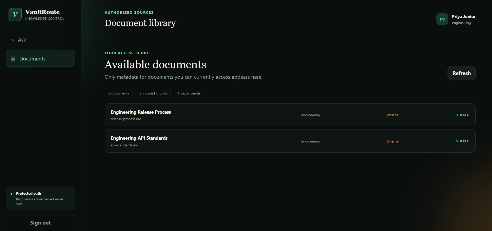 |

| Unauthorized knowledge refusal | Grounded Groq answer |
|---|---|
| 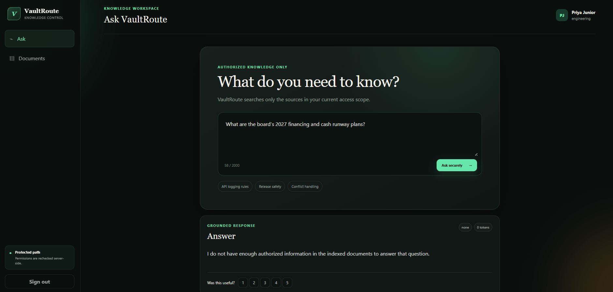 | 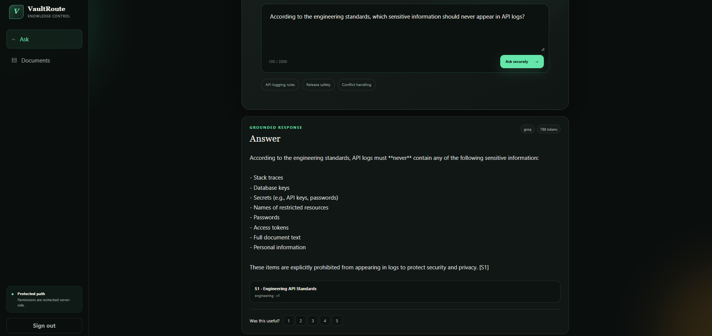 |

| Zero-token semantic cache hit | OpenAI multi-document route |
|---|---|
| 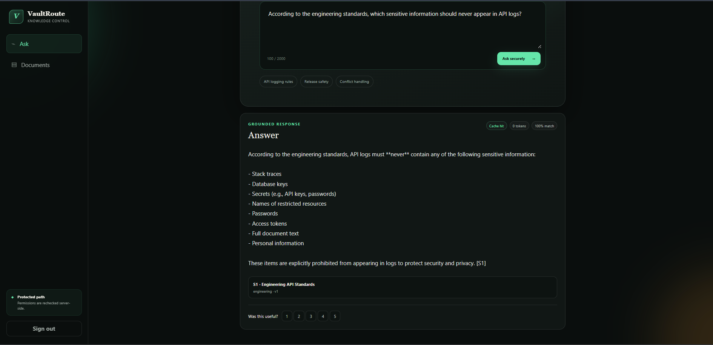 | 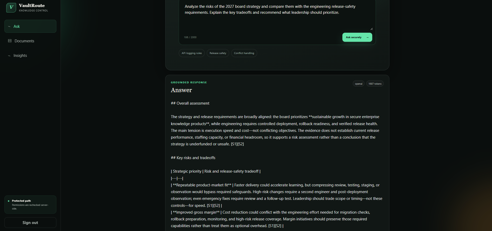 |

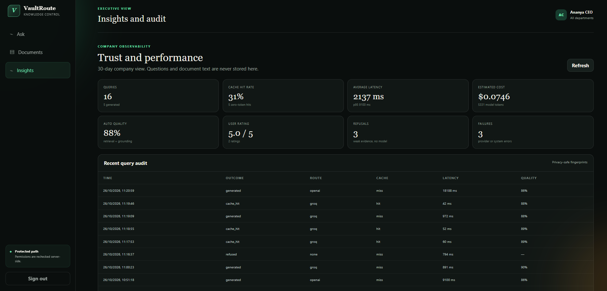

## Production notes

`docker-compose.prod.yml` runs the API as a non-root user with a read-only filesystem, keeps PostgreSQL and Qdrant off public ports, and requires production-safe secrets and explicit allowed hosts. Before real company use, add:

- TLS through a reverse proxy or load balancer;
- managed secrets and key rotation;
- SSO/OIDC and user lifecycle provisioning;
- shared rate limiting and centralized metrics for multiple API replicas;
- malware scanning and richer document update/delete workflows;
- encrypted off-machine backups, retention rules, alerts, and a practiced restore drill;
- a larger human-reviewed evaluation set.

This repository is a strong personal-project implementation and production-oriented reference, but deployment security still depends on the owner's infrastructure, secret management, policies, and operating procedures.
